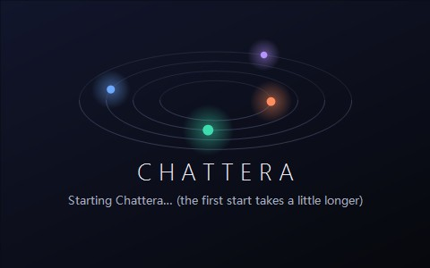
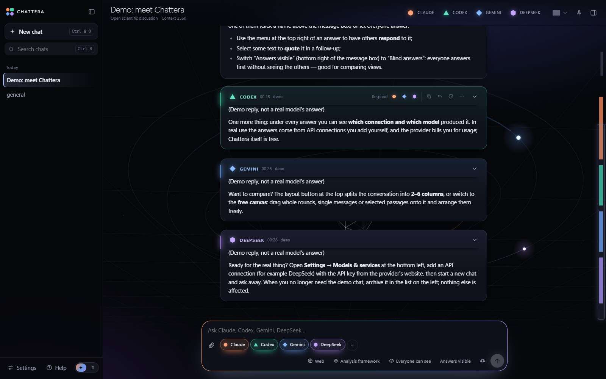
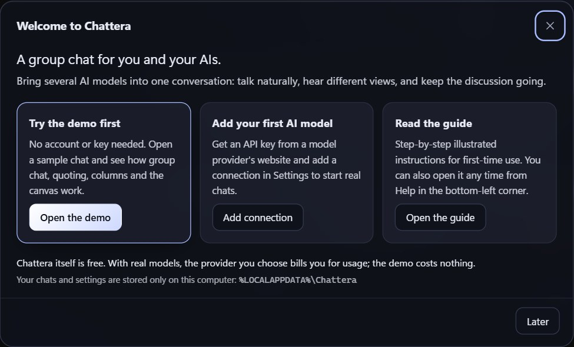
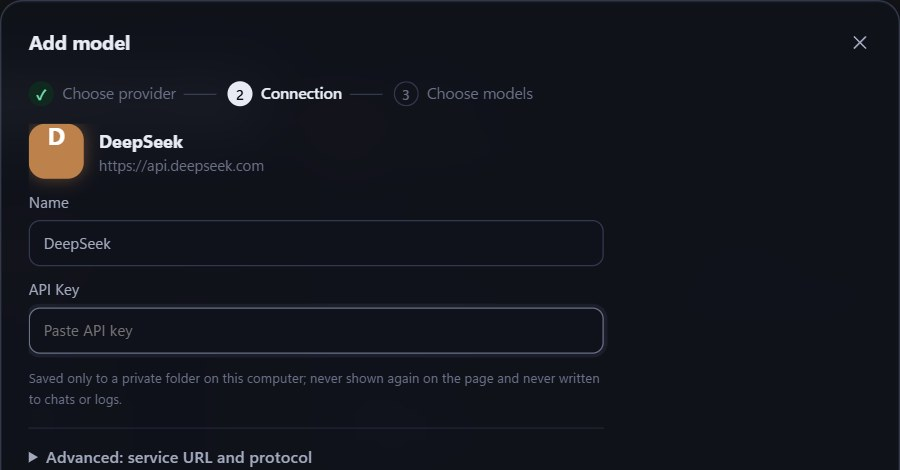
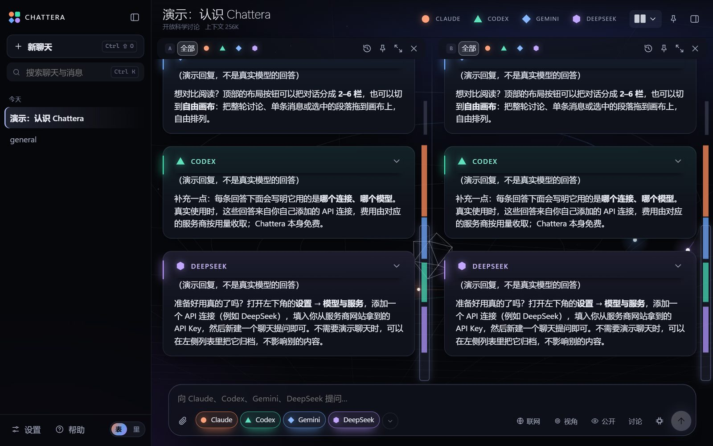
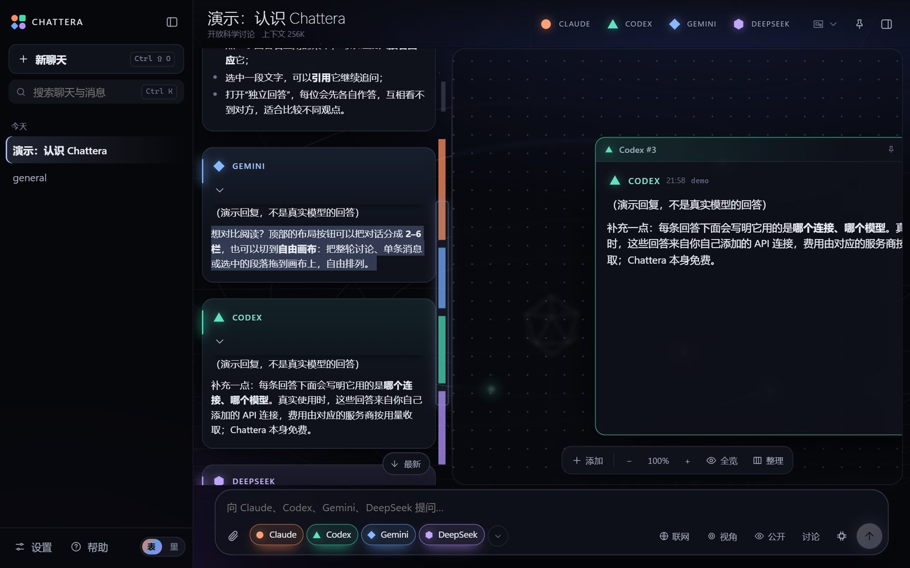
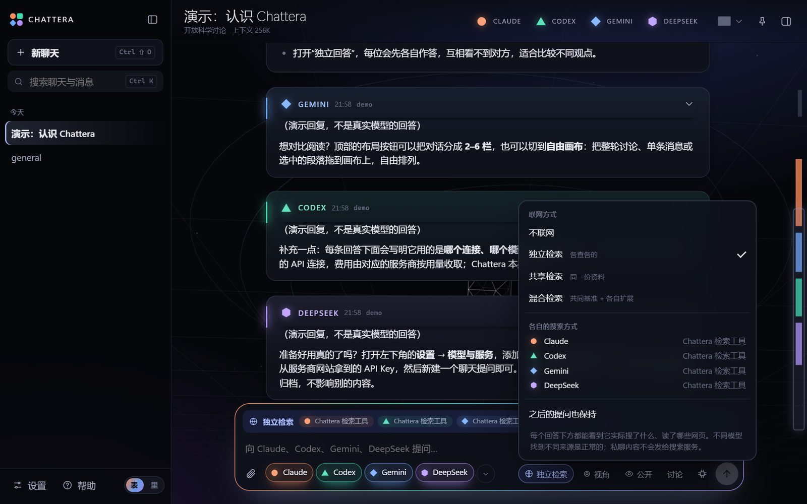
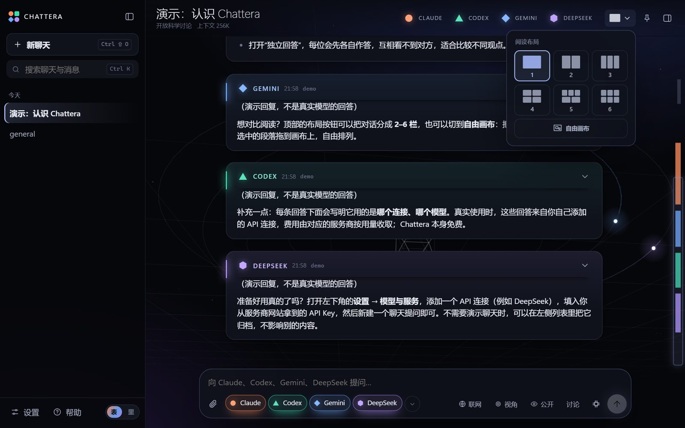

  

<h3 align="center">A group chat for you and your AIs.</h3>

  Bring several AI models into one conversation. Talk naturally, hear different views, and keep the discussion going.

  
  
  
  

  <b>English</b> · <a href="README.zh-CN.md">简体中文</a>

---

Chattera runs on your own computer. Add the models you want through their API — DeepSeek, OpenAI, Anthropic, Google
Gemini, Qwen, Kimi, GLM, OpenRouter or any OpenAI-compatible endpoint — and talk to them together: ask everyone or one
by name, let them respond to each other, compare blind answers, read side by side, and lay a discussion out on a
free canvas.

It's a chat, not an agent platform: models don't run commands or touch your files. For research they keep notes and
downloaded papers in each chat's own chat folder, and nowhere else.

> **Free.** Chattera is open source (MIT). With real models, the provider you choose bills you directly for API usage.
> The demo calls no model and costs nothing.

## Get started in five minutes

| | |
|---|---|
| **1. Download** | Get `Chattera-Windows-x64.zip` from [Releases](https://github.com/real-Keymio/Chattera/releases) and unzip it anywhere. No Python, no installer. |
| **2. Start** | Double-click `Chattera.exe`. The first start takes about ten seconds. |
| **3. Try the demo** | Choose **Open the demo** in the welcome window — no account or key needed. |
| **4. Add a real model** | **Settings → Models & services → Add model**: pick a provider, paste your API key, tick a model. |

  
  

The interface follows your Windows display language (English or Chinese); switch it any time in
**Settings → General → Language**. The ZIP includes an illustrated quick start, `01_Start_Here.pdf`.

## What it does

<table>
<tr>
<td width="50%" valign="top">
<b>Group chat</b> 
Several models in one conversation. Ask everyone, or name one; let a model respond to another's answer; quote a
passage and follow up.
</td>
<td width="50%" valign="top">
<b>Blind answers</b> 
Everyone answers without seeing the others, and nothing is shared until you reveal it — for comparing views honestly.
</td>
</tr>
<tr>
<td valign="top">
<b>Web search you can check</b> 
Each model uses its provider's own search (or Chattera's), or everyone gets the same retrieved material. Every answer
shows what was actually searched and read.
</td>
<td valign="top">
<b>Private messages</b> 
Talk to a subset of the models; the others never see it. Enforced on the server, including attachments and quotes.
</td>
</tr>
<tr>
<td valign="top">
<b>Read side by side</b> 
1–6 synchronized reading panes, or a free canvas for whole rounds, single answers, quoted passages, PDF pages and notes.
</td>
<td valign="top">
<b>Research library</b> 
Per-chat library of the papers and pages the models actually used, with DOI / arXiv identity, notes and full text on
demand.
</td>
</tr>
<tr>
<td valign="top">
<b>Documents</b> 
PDF, Word, HTML, text and images as attachments; text recognition (OCR) for scanned PDFs is built in.
</td>
<td valign="top">
<b>Local by design</b> 
Chats, settings and keys stay in <code>%LOCALAPPDATA%\Chattera</code>. Chattera listens on 127.0.0.1 only. The library and
caches can live in a folder you choose, such as a cloud drive.
</td>
</tr>
<tr>
<td valign="top">
<b>Long research, like a web chat</b> 
No fixed number of searches: a model searches and reads until it has enough, then answers; you see how far it has got
and can stop it any time. Each chat has a chat folder for notes, tables and downloaded open-access papers.
</td>
<td valign="top">
<b>Branch and delete</b> 
Branch from any message into a fully independent copy (research library included); delete a chat for good, with its
attachments, records and chat folder.
</td>
</tr>
</table>

### A closer look

<table>
<tr>
<td width="50%"></td>
<td width="50%"></td>
</tr>
<tr>
<td align="center">Side-by-side reading panes</td>
<td align="center">Free canvas: put answers and passages next to each other</td>
</tr>
<tr>
<td></td>
<td></td>
</tr>
<tr>
<td align="center">Independent, shared or hybrid web search</td>
<td align="center">1–6 reading panes or the free canvas</td>
</tr>
</table>

These four screenshots show the Chinese interface; everything is also available in English.

## Install

- **Windows portable package** — for everyone. Unzip and run; see [docs/INSTALL.md](docs/INSTALL.md#portable).
- **From source** — for developers and their coding agents. `scripts\setup.ps1` checks Python, creates a virtual
  environment, installs, runs the tests and starts Chattera. Coding agents should read [AGENTS.md](AGENTS.md) first.

## Documentation

| | |
|---|---|
| [INSTALL](docs/INSTALL.md) | Portable package, source install, data folder, portable mode, ports, OCR |
| [ARCHITECTURE](docs/ARCHITECTURE.md) | How the pieces fit together |
| [PRIVACY_AND_COMPLIANCE](docs/PRIVACY_AND_COMPLIANCE.md) | Where your data goes, provider terms, security |
| [CLI_ADAPTER](docs/CLI_ADAPTER.md) | The adapter interface for locally installed official CLIs |
| [AGENTS](AGENTS.md) | Instructions for coding agents |
| [CONTRIBUTING](CONTRIBUTING.md) · [SECURITY](SECURITY.md) · [CHANGELOG](CHANGELOG.md) | Contributing, reporting vulnerabilities, release notes |
| [THIRD_PARTY_NOTICES](THIRD_PARTY_NOTICES.md) | Third-party software and licenses |

## Known limitations

- The portable package is Windows 10/11 x64 only. macOS and Linux can run from source but are **untested**.
- Local use only: there is no user authentication, so don't expose it to a network.
- No account sync or mobile app. History within a chat is append-only by design (a whole chat can be deleted).
- No audio, video or image generation.
- The full user guide is Chinese only for now; the English quick start covers the first chat.

## Acknowledgements

Chattera was built with AI coding agents: OpenAI Codex wrote most of the early backend, and Claude Code did much of
the later work, including the interface and this release. Both are credited as co-authors in the commit history.

## License

MIT — see [LICENSE](LICENSE). Chattera is built on [agentchattr](https://github.com/bcurts/agentchattr) by Ben Curtis (MIT).
