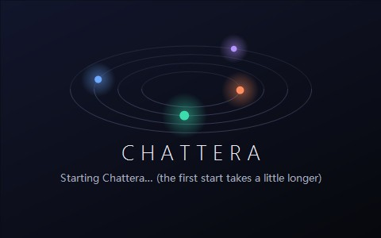
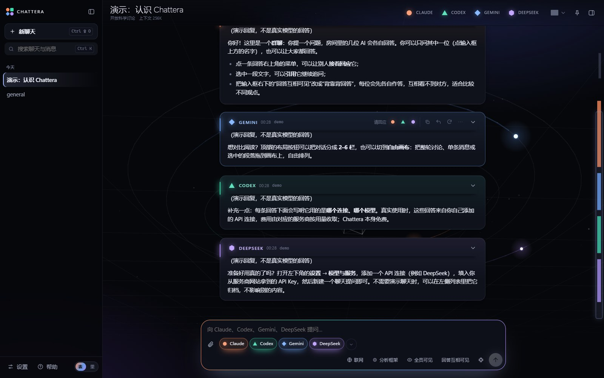
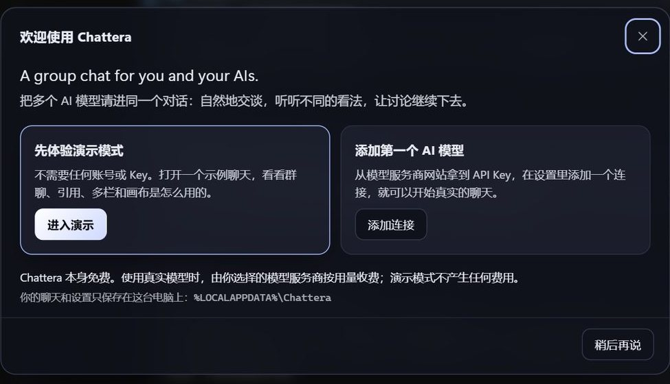
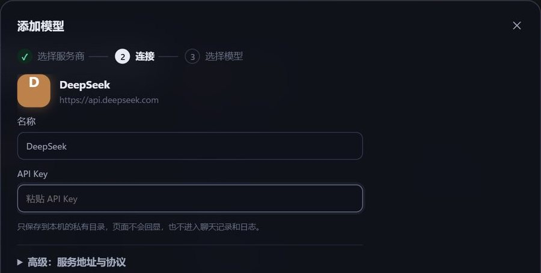
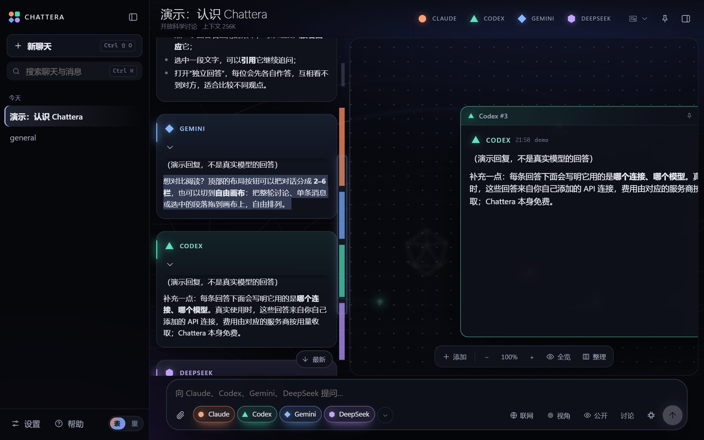

  

<h3 align="center">你和多个 AI 的群聊</h3>

  把几个 AI 模型请进同一个对话：自然地交谈，听听不同的看法，让讨论继续下去。

  
  
  
  

  <a href="README.md">English</a> · <b>简体中文</b>

---

Chattera 运行在你自己的电脑上。通过 API 接入你想用的模型：DeepSeek、OpenAI、Anthropic、Google Gemini、通义千问、
Kimi、智谱 GLM、OpenRouter，或任何 OpenAI 兼容的服务。然后和它们一起聊：

- 可以一起问，也可以单独点名；
- 让它们互相回应，或者背靠背作答再比较；
- 多栏对照阅读，在自由画布上整理讨论。

它是一个聊天工具，不是智能体平台：模型不会运行命令，也碰不到你的文件。做调研时，它们只能在每个聊天自己的“聊天文件夹”里记笔记、存下载的论文。

> **免费。**Chattera 开源（MIT）。使用真实模型时，费用由你选择的模型服务商按 API 用量直接向你收取；演示模式不调用任何模型，不产生费用。

## 五分钟上手

| | |
|---|---|
| **1. 下载** | 从 [Releases](https://github.com/real-Keymio/Chattera/releases) 下载 `Chattera-Windows-x64.zip`，解压到任意位置。不需要 Python，也不用安装。 |
| **2. 启动** | 双击 `Chattera.exe`。第一次启动大约需要十几秒。 |
| **3. 体验演示** | 在欢迎页点 **进入演示**，不需要账号或 Key。 |
| **4. 接入真实模型** | **设置 → 模型与服务 → 添加模型**：选服务商，粘贴 API Key，勾选模型。 |

  
  

界面支持中文和英文，默认跟随 Windows 的显示语言，可以在 **设置 → 通用 → 语言** 里随时切换。
压缩包里附有两份图文指南：`01_先看这个.pdf`（第一次聊天）和 `02_Chattera完整使用指南.pdf`（全部功能与常见问题）。

## 能做什么

<table>
<tr>
<td width="50%" valign="top">
<b>群聊</b> 
几个模型在同一个对话里。可以一起问，也可以单独点名；让一个模型回应另一个的回答；引用一段话继续追问。
</td>
<td width="50%" valign="top">
<b>背靠背回答</b> 
每位先各自作答、互相看不到对方，由你确认后才公开，适合真实地比较不同观点。
</td>
</tr>
<tr>
<td valign="top">
<b>可追溯的联网检索</b> 
每个模型用自家服务商的搜索（没有时用 Chattera 的检索），或者大家拿同一份检索资料。每条回答都能看到实际搜了什么、读了什么。
</td>
<td valign="top">
<b>私聊</b> 
只和其中几个模型说话，其他模型看不到。由服务器强制执行，附件和引用也一样。
</td>
</tr>
<tr>
<td valign="top">
<b>对照阅读</b> 
1–6 个同步的阅读视口；或者用自由画布摆放整轮讨论、单条回答、引用片段、PDF 页面和笔记。
</td>
<td valign="top">
<b>资料库</b> 
每个聊天一份资料库，记录模型实际用到的论文和网页，带 DOI / arXiv 标识和笔记，按需获取全文。
</td>
</tr>
<tr>
<td valign="top">
<b>文档</b> 
支持 PDF、Word、HTML、文本和图片附件；扫描版 PDF 自带文字识别（OCR）。
</td>
<td valign="top">
<b>数据只在本机</b> 
聊天、设置和 Key 保存在 <code>%LOCALAPPDATA%\Chattera</code>，只在 127.0.0.1 上运行。资料库和缓存可以放到你指定的文件夹，比如云盘。
</td>
</tr>
<tr>
<td valign="top">
<b>像网页版一样的长时间调研</b> 
不设固定的搜索次数，模型自己决定查多少、读多少，觉得够了再作答；你能看到它走到了哪一步，随时可以停。每个聊天有一个“聊天文件夹”，模型可以在里面记笔记、存表格、下载开放获取的论文。
</td>
<td valign="top">
<b>分支与删除</b> 
从任意一条消息建立分支，得到一份完全独立的副本（连同资料库）；不需要的聊天可以永久删除，附件、记录和聊天文件夹一起清除。
</td>
</tr>
</table>

### 看看界面

<table>
<tr>
<td width="50%"></td>
<td width="50%"></td>
</tr>
<tr>
<td align="center">双栏对照阅读</td>
<td align="center">自由画布：把回答和片段并排摆放</td>
</tr>
<tr>
<td></td>
<td></td>
</tr>
<tr>
<td align="center">独立、共享或混合的联网检索</td>
<td align="center">1–6 个阅读视口或自由画布</td>
</tr>
</table>

## 安装

- **Windows 便携版**：适合所有人，解压即用，详见 [docs/INSTALL.md](docs/INSTALL.md#portable)。
- **从源码运行**：适合开发者和他们的编程助手。`scripts\setup.ps1` 会检查 Python、创建虚拟环境、安装依赖、运行测试并启动 Chattera。编程助手请先读 [AGENTS.md](AGENTS.md)。

## 文档

开发文档目前只有英文：

| | |
|---|---|
| [INSTALL](docs/INSTALL.md) | 便携版、源码安装、数据文件夹、便携模式、端口、OCR |
| [ARCHITECTURE](docs/ARCHITECTURE.md) | 整体结构 |
| [PRIVACY_AND_COMPLIANCE](docs/PRIVACY_AND_COMPLIANCE.md) | 数据去向、服务商条款、安全 |
| [CLI_ADAPTER](docs/CLI_ADAPTER.md) | 本机官方命令行工具的适配接口 |
| [AGENTS](AGENTS.md) | 给编程助手的说明 |
| [CONTRIBUTING](CONTRIBUTING.md) · [SECURITY](SECURITY.md) · [CHANGELOG](CHANGELOG.md) | 参与贡献、报告漏洞、版本记录 |
| [THIRD_PARTY_NOTICES](THIRD_PARTY_NOTICES.md) | 第三方软件与许可 |

## 已知限制

- 便携版只支持 Windows 10/11 x64。macOS 和 Linux 可以从源码运行，但**未经测试**。
- 只适合本机使用：没有用户认证，不要把它暴露到网络上。
- 没有账号同步，也没有手机版。聊天内的历史记录按设计只追加、不改写（整个聊天可以永久删除）。
- 不支持音频、视频和图片生成。

## 致谢

Chattera 是和 AI 编程助手一起写出来的：早期的后端大部分由 OpenAI Codex 完成，后来的界面和这次发布等工作大多由
Claude Code 完成。两者都作为共同作者记录在提交历史里。

## 许可

MIT，见 [LICENSE](LICENSE)。Chattera 基于 Ben Curtis 的 [agentchattr](https://github.com/bcurts/agentchattr)（MIT）。
